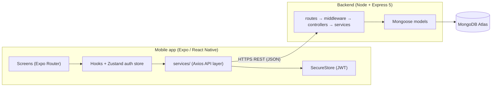
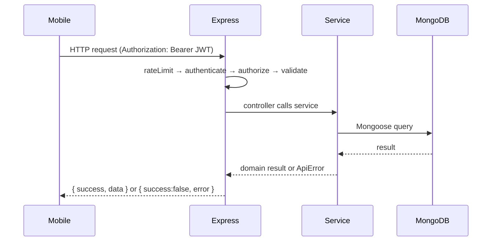
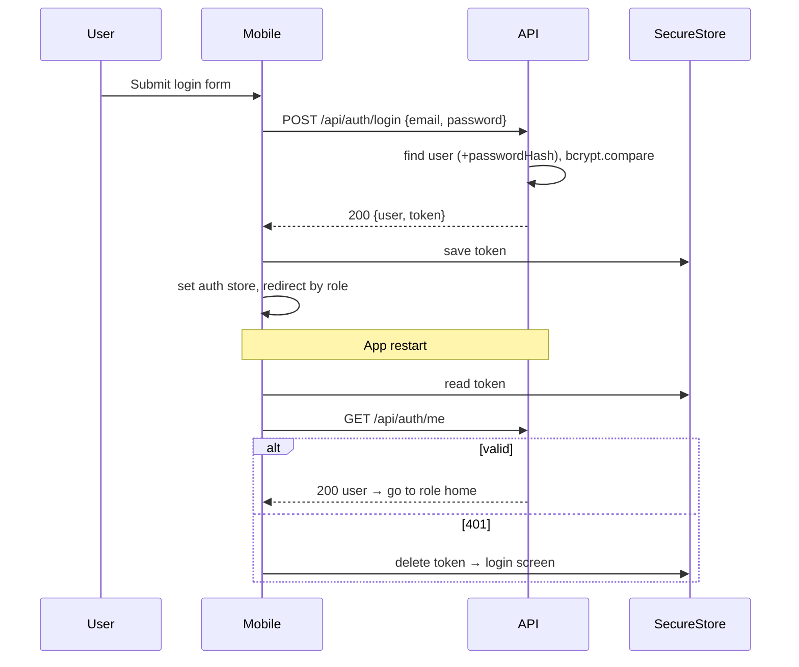
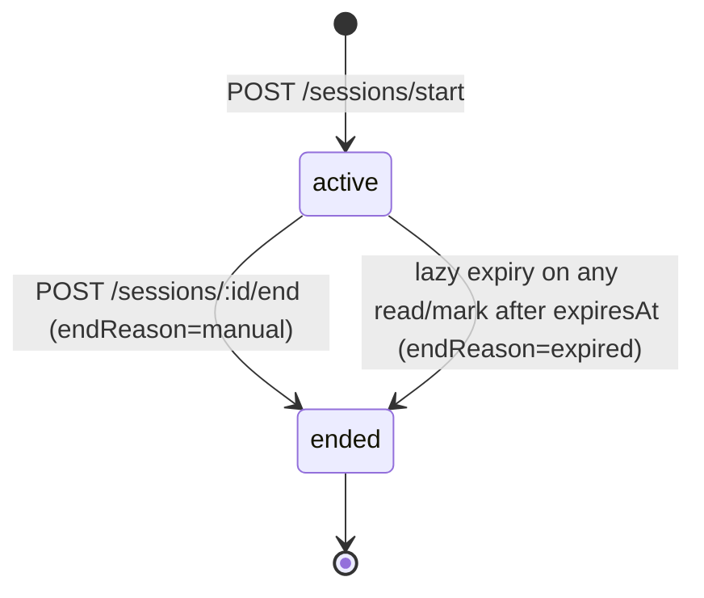
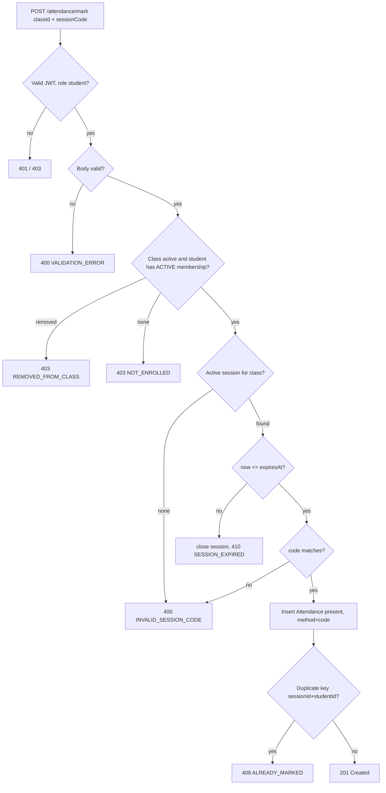
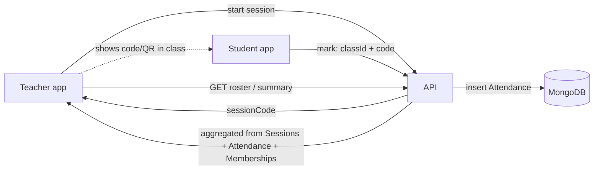

# ARCHITECTURE — Teacher–Student Attendance Management App

> Related: [PRD](PRD.md) · [TECH_STACK](TECH_STACK.md) · [DATABASE](DATABASE.md) · [API](API.md) · [DESIGN](DESIGN.md) · [AGENTS](AGENTS.md) · [TASKS](TASKS.md)

---

## 1. High-Level Architecture

**The only communication path:**

`Mobile App → Axios (HTTP/HTTPS) → Express REST API → Mongoose → MongoDB Atlas`
Responses return through the same HTTP request/response cycle. No WebSockets, Socket.IO, SSE, or persistent connections. No background jobs or cron; time-based rules are evaluated **lazily** on each request.



## 2. Mobile Frontend Architecture

- **Routing:** Expo Router file-based routes. Three groups: `(auth)`, `(teacher)`, `(student)`. The root `_layout.tsx` reads the auth store and redirects: no token → `(auth)/login`; role `teacher` → `(teacher)`; role `student` → `(student)`.
- **State:** Zustand holds only `{ user, token, status: 'loading'|'authenticated'|'unauthenticated' }`. Everything else (classes, sessions, attendance) is fetched by the screen via hooks (`useClasses`, `useAttendanceSummary`, …) with local `loading/error/data` state and pull-to-refresh. No global cache layer in the MVP.
- **API layer:** `services/api.ts` (single Axios instance, base URL from env, interceptors) and one file per module (`authService`, `classService`, `sessionService`, `attendanceService`). Screens never call Axios directly.
- **Forms:** React Hook Form + Zod schemas (mirroring backend validators).
- **UI:** Reusable components in `components/` per DESIGN.md. Tokens in `constants/theme.ts`.
- **Freshness without polling:** data refreshes on screen focus (`useFocusEffect`), pull-to-refresh, and after any mutation. The teacher's session screen has an explicit "Refresh" action; no timers that call the API.
- **Countdown:** the session countdown is a local UI timer computed from the server's `expiresAt` and `serverTime` (offset correction) — it performs **no** network calls.

## 3. Backend Architecture

Layered, minimal:

`route → (rateLimiter) → authenticate → authorize(role) → validate(zod) → controller → service → model`

| Layer | Responsibility |
|---|---|
| `routes/` | Declare endpoints, attach middleware chain. |
| `middleware/` | `authenticate`, `authorize`, `validate`, `rateLimiters`, `errorHandler`, `notFound`. |
| `validators/` | Zod schemas per module (body/query/params). |
| `controllers/` | Thin: read validated input, call a service, shape the response. No business logic. |
| `services/` | Business rules, ownership checks, lazy session expiry, percentage calculation. Only layer that touches models. |
| `models/` | Mongoose schemas, indexes, instance helpers. |
| `utils/` | `ApiError`, `asyncHandler` (optional in Express 5), `jwt`, `joinCode`, `sessionCode`, `percentage`, `response`. |
| `config/` | `env.ts` (Zod-validated env), `db.ts` (Mongoose connection), `constants.ts`. |
| `types/` | Shared TS types, Express request augmentation (`req.user`). |

## 4. REST API Communication Flow



## 5. Authentication Flow


Logout: client deletes the token from SecureStore and clears the store; `POST /api/auth/logout` returns `200` (stateless, no server-side revocation in MVP).

## 6. Authorization Flow

1. `authenticate`: verify JWT → load user by `sub` → reject if missing or `isActive=false` → set `req.user = {id, role}`.
2. `authorize('teacher')` / `authorize('student')`: role gate.
3. **Ownership checks live in services** (never trust IDs from the client):
   - Teacher resources: `class.teacherId === req.user.id`.
   - Student resources: active `ClassMembership` for `(classId, req.user.id)`.
   - `attendance.classId` is derived from the session on the server, never from the client body.
4. Not-found vs forbidden: for resources the caller should not know exist (another teacher's class), respond `404`; for known-but-disallowed actions (student calling a teacher endpoint) respond `403`.

## 7. Class Management Flow

- **Create:** teacher → `POST /api/classes` → service generates unique `joinCode` (retry on duplicate-key error, max 5) → `201`.
- **Join:** student → `POST /api/classes/join {joinCode}` → find active class → check existing membership (`active` → `409`, `removed` → `403`) → create membership (unique index guards races).
- **Remove student:** teacher → `DELETE /api/classes/:id/students/:studentId` → membership `status='removed'`.
- **Delete class:** teacher → `DELETE /api/classes/:id` → `isActive=false`, `deletedAt=now`; active session (if any) is ended; history retained.

## 8. Attendance Session Flow


- **Start:** verify teacher owns class → lazily close any *expired* active session of that class → create session `{sessionCode, startedAt, expiresAt}` → partial unique index (one active per class) turns races into `409 SESSION_ALREADY_ACTIVE`.
- **Completed session** (used for percentages) = `status='ended'` **or** `expiresAt <= now`. Calculations never depend on the lazy write having happened.
- **Visibility:** `sessionCode` is returned **only** to the owning teacher.

## 9. Attendance Marking Flow


Manual marking (`POST /attendance/manual`) upserts `(sessionId, studentId)` with `method='manual'` and `markedBy=teacherId`, allowed for any session of the teacher's class, including ended ones, for active members only.

## 10. Error-Handling Architecture

- Services throw `ApiError(statusCode, code, message, details?)`.
- Zod failures are converted by `validate` to `400 VALIDATION_ERROR` with `details: [{field, message}]`.
- Mongo duplicate key (`code 11000`) is mapped in the error handler: attendance → `ALREADY_MARKED`, membership → `ALREADY_ENROLLED`, user email → `EMAIL_ALREADY_EXISTS`, active-session index → `SESSION_ALREADY_ACTIVE`.
- JWT errors → `401 UNAUTHORIZED`.
- Unknown errors → `500 INTERNAL_ERROR` with generic message; stack trace only when `NODE_ENV !== 'production'`, logged server-side.
- Unmatched routes → `404 NOT_FOUND`.
- **Mobile:** Axios response interceptor normalizes errors to `{code, message, status}`. `401` → clear token + redirect to login (except on the login call). Screens show `ErrorState` with retry; forms show field errors from `details`; network failure → "Can't reach server" message.

## 11. Security Architecture

| Concern | Mechanism |
|---|---|
| Transport | HTTPS in production; HTTP allowed only on LAN in dev. |
| Passwords | bcryptjs, cost from env, max 72 chars. |
| Token | JWT HS256, 7d, secret from env; client stores in SecureStore only. |
| AuthZ | RBAC + ownership checks in services. |
| Input | Zod on body/query/params; `express.json({ limit: '10kb' })`. |
| Abuse | `express-rate-limit`: global 100 req/15 min/IP; `/auth/*` 10 req/15 min/IP; `/attendance/mark` 10 req/min per user. |
| Headers | Helmet defaults. |
| CORS | Allow-list from `CORS_ORIGINS`. |
| Data exposure | `passwordHash` has `select: false`; DTO mappers whitelist response fields; `sessionCode` teacher-only. |
| Secrets | `.env` git-ignored; env validated at boot. |
| NoSQL injection | Zod coerces types (strings only); never pass raw `req.body`/`req.query` objects into Mongoose filters. |

## 12. Data Flow Diagram (marking, simplified)



## 13. Complete Folder Structure

Improvements over the starter structure: removed `sockets/`; documentation lives in the **repo root** (as required); added `constants.ts`/`env.ts` under `config/`.

```
attendance-app/
├── PRD.md  TECH_STACK.md  ARCHITECTURE.md  DATABASE.md
├── API.md  DESIGN.md  AGENTS.md  TASKS.md
├── .gitignore
│
├── backend/
│   ├── src/
│   │   ├── config/        env.ts, db.ts, constants.ts
│   │   ├── models/        User.ts, Class.ts, ClassMembership.ts, AttendanceSession.ts, Attendance.ts
│   │   ├── controllers/   auth, class, session, attendance controllers
│   │   ├── routes/        index.ts, auth.routes.ts, class.routes.ts, session.routes.ts, attendance.routes.ts
│   │   ├── services/      auth, class, session, attendance services
│   │   ├── middleware/    authenticate.ts, authorize.ts, validate.ts, rateLimiters.ts, errorHandler.ts
│   │   ├── validators/    auth, class, session, attendance zod schemas
│   │   ├── utils/         ApiError.ts, jwt.ts, joinCode.ts, sessionCode.ts, percentage.ts, response.ts
│   │   ├── types/         express.d.ts, dto types
│   │   ├── app.ts         Express app (no listen) — importable by tests
│   │   └── server.ts      loads env, connects DB, listens
│   ├── tests/
│   ├── .env.example
│   ├── tsconfig.json
│   └── package.json
│
└── mobile/
    ├── app/
    │   ├── _layout.tsx            root: auth bootstrap + role redirect
    │   ├── index.tsx              redirect entry
    │   ├── (auth)/                login.tsx, register.tsx
    │   ├── (teacher)/             (tabs)/ index.tsx, profile.tsx · classes/create.tsx · classes/[id]/index.tsx, students.tsx, history.tsx, start-session.tsx · sessions/[id].tsx · settings.tsx
    │   └── (student)/             (tabs)/ index.tsx, classes.tsx, profile.tsx · join-class.tsx · classes/[id]/index.tsx, mark.tsx, history.tsx · settings.tsx
    ├── components/        PrimaryButton, SecondaryButton, InputField, AppHeader, ClassCard, StudentCard, AttendanceCard, StatusBadge, LoadingIndicator, EmptyState, ErrorState, ConfirmationModal
    ├── hooks/             useAuth, useClasses, useSessions, useAttendance, useRefreshOnFocus
    ├── services/          api.ts, tokenStorage.ts, authService.ts, classService.ts, sessionService.ts, attendanceService.ts
    ├── store/             authStore.ts
    ├── constants/         theme.ts, config.ts
    ├── types/             api.ts, models.ts
    ├── utils/             formatDate.ts, percentage.ts, errors.ts, schemas.ts (zod)
    ├── assets/
    ├── .env.example
    └── package.json
```

## 14. Polling Strategy

**There is none.** The app uses fetch-on-focus, pull-to-refresh, post-mutation refetch, and an explicit Refresh button. Students learn that a session is running because the teacher announces the code in the room; the student opens Mark Attendance and enters it. The student class-details screen may show "A session may be active — enter the code" based on data fetched on focus (`GET /api/classes/:id` returns `activeSession: {id, expiresAt}` without the code).

## 15. Cross-Document Traceability

| Feature (PRD) | Endpoints (API) | Collections (DATABASE) | Screens (DESIGN) |
|---|---|---|---|
| FR-01/02 Auth | `/auth/register, login, logout, me` | User | Login, Register, Profile, Settings |
| FR-03/04 Class CRUD | `POST/GET/PUT/DELETE /classes` | Class | Dashboard, Create Class, Class Details |
| FR-05 Join | `POST /classes/join` | ClassMembership | Join Class |
| FR-06 Students | `GET /classes/:id/students`, `DELETE /classes/:id/students/:studentId` | ClassMembership, User | Student List |
| FR-07/08/11 Sessions | `/sessions/start`, `GET /sessions`, `GET /sessions/:id`, `/sessions/:id/end` | AttendanceSession | Start Attendance, Attendance Session |
| FR-09/10 Mark | `POST /attendance/mark` | Attendance | Mark Attendance |
| FR-12 Manual | `POST /attendance/manual` | Attendance | Attendance Session (roster actions) |
| FR-13 Teacher views | `GET /attendance/session/:id`, `/attendance/class/:id/summary`, `/attendance/student/:id` | Attendance, Session, Membership | Attendance History, Student List |
| FR-14/15 Student views | `GET /attendance/my` | Attendance, Session, Membership | Student Dashboard, Attendance History, Attendance Percentage |

## 16. Architecture Decisions (ADR summary)

1. **REST only, lazy time rules** — no sockets, no cron; expiry evaluated on access.
2. **Only-present records** — absence is derived; manual `absent` is an explicit override.
3. **Class-scoped session code** — lookup by `(classId, status=active)` then compare code; reduces brute-force surface.
4. **`app.ts` / `server.ts` split** — enables Supertest without opening a port.
5. **Service layer owns authorization** — controllers stay thin and testable.
6. **No Redux/React Query** — Zustand for auth only; simple fetch hooks for MVP.
