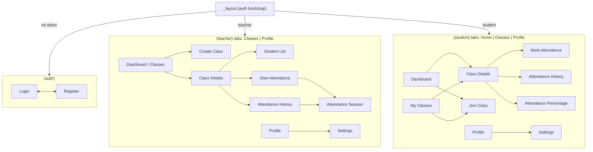

# DESIGN — UI/UX System

> Related: [PRD](PRD.md) · [ARCHITECTURE](ARCHITECTURE.md) · [API](API.md)
> Style: modern, minimal, professional, clean, premium, easy to navigate. Light theme only (MVP). No React Native code in this document.

---

## 1. Design Principles

1. **One primary action per screen** (Start Attendance, Mark Attendance, Join Class).
2. **Generous whitespace, soft cards, quiet colors**; color is used for meaning (status), not decoration.
3. **Large touch targets** (min 48×48 dp) — teachers use this one-handed in a classroom.
4. **Always show state:** loading, empty, error, disabled, success.
5. **Human error messages** ("That code didn't match. Check with your teacher.") — never raw codes.
6. **Accessibility:** text contrast ≥ 4.5:1, status never conveyed by color alone (icon + label), support system font scaling.

## 2. Design Tokens (`constants/theme.ts`)

### Colors
| Token | Hex | Use |
|---|---|---|
| `primary` | `#4F46E5` | Primary buttons, active tab, links |
| `primaryPressed` | `#4338CA` | Pressed state |
| `primarySoft` | `#EEF2FF` | Tinted backgrounds, selected chips |
| `secondary` | `#0D9488` | Secondary accents, progress fills |
| `background` | `#F8FAFC` | Screen background |
| `surface` | `#FFFFFF` | Cards, inputs, modals |
| `border` | `#E2E8F0` | Dividers, input borders |
| `textPrimary` | `#0F172A` | Headings, body |
| `textSecondary` | `#475569` | Supporting text |
| `textMuted` | `#94A3B8` | Placeholders, disabled text |
| `textOnPrimary` | `#FFFFFF` | Text on primary |
| `success` / `successSoft` | `#16A34A` / `#DCFCE7` | Present, success |
| `error` / `errorSoft` | `#DC2626` / `#FEE2E2` | Absent, errors, destructive |
| `warning` / `warningSoft` | `#D97706` / `#FEF3C7` | Low attendance, expiring session |
| `disabledBg` | `#E2E8F0` | Disabled buttons |
| `overlay` | `rgba(15,23,42,0.5)` | Modal backdrop |

### Typography
System font (San Francisco / Roboto) — no font loading in MVP. Optional later: Inter.

| Style | Size | Weight | Line height | Use |
|---|---|---|---|---|
| `display` | 32 | 700 | 40 | Session code |
| `h1` | 24 | 700 | 32 | Screen titles |
| `h2` | 20 | 600 | 28 | Section headers |
| `h3` | 17 | 600 | 24 | Card titles |
| `body` | 15 | 400 | 22 | Default |
| `bodyStrong` | 15 | 600 | 22 | Emphasis |
| `caption` | 13 | 400 | 18 | Meta text |
| `button` | 16 | 600 | 24 | Buttons |

Font weights used: 400, 600, 700 only.

### Spacing (4-pt scale)
`xs 4 · sm 8 · md 12 · lg 16 · xl 24 · 2xl 32 · 3xl 48`. Screen horizontal padding: **16**. Card padding: **16**. Gap between cards: **12**.

### Border radius
`sm 8 (badges, chips) · md 12 (inputs, buttons) · lg 16 (cards) · xl 24 (modals/sheets) · full 999 (pills, avatars)`.

### Shadows (very subtle)
- `card`: offset 0/1, blur 3, opacity 0.06 (iOS) · elevation 1 (Android)
- `raised` (modals): offset 0/8, blur 24, opacity 0.12 · elevation 8

### Icons
`@expo/vector-icons` → **Ionicons** outline set, 24 px (20 in lists, 28 in empty states). Mapping: home `home-outline`, classes `book-outline`, profile `person-outline`, settings `settings-outline`, add `add-circle-outline`, present `checkmark-circle`, absent `close-circle`, time `time-outline`, QR `qr-code-outline`, scan `scan-outline`, warning `warning-outline`.

---

## 3. Navigation Structure



**Tab bars:** Teacher — *Classes*, *Profile*. Student — *Home*, *Classes*, *Profile*. Settings is reached from Profile (header gear icon).

---

## 4. Teacher Screens

> Wireframe legend: `[ Button ]` · `( input )` · `▢` card · `…` list repeats.

### T1. Login (shared layout, role chosen at registration)
```
        ◉ Attendance
   Welcome back
 ( Email                 )
 ( Password            👁 )
 [        Log in         ]
 New here?  Create account
```
States: default · loading (button spinner, inputs disabled) · error (inline field errors; banner for "Invalid email or password") · disabled (button disabled until valid).

### T2. Registration
```
 Create account
 ( Full name )  ( Email )  ( Password )
 I am a:  [ Teacher ] [ Student ]     ← segmented
 (Roll number)  (Enrollment no. – optional)   ← shown only for Student
 [        Create account        ]
```
States: same as login; roll number field appears/disappears with role.

### T3. Dashboard (Classes tab)
```
 Hello, Prof. Mehta                [+ New]
 ▢ Data Structures — A   CS301
    42 students   ● Session active 06:12
 ▢ DBMS — B              CS305
    38 students
 …
```
- Pull-to-refresh. Tapping a card opens Class Details. Active-session chip (warning color) shown when `activeSession` exists.
- States: loading (3 skeleton cards) · empty ("No classes yet — create your first class") · error (retry).

### T4. Create Class
```
 ‹ New class
 ( Class name )   ( Subject code )
 ( Description – optional, multiline )
 [        Create class        ]
```
Success → navigate to Class Details with join code highlighted + Copy button.

### T5. Class Details
```
 ‹ Data Structures — A
 Join code   K7MX4P   [Copy]
 42 students
 [      Start attendance      ]   ← primary
 ▢ Students            ›
 ▢ Attendance history  ›
 ⋯ Edit class · Delete class
```
If a session is active, the primary button becomes **"View live session"**. Delete uses ConfirmationModal.

### T6. Student List
```
 ‹ Students (42)
 ( Search name or roll no. )
 ▢ Riya Patel      21CE045   85.7%   ⋯ Remove
 …
```
States: loading · empty ("No students yet — share the join code") · error. Remove → ConfirmationModal.

### T7. Start Attendance
```
 ‹ Start attendance
 Class: Data Structures — A
 Duration    [ 5 ] [ 10 ] [ 15 ] [ 30 ]   (chips; default 10)
 ( Title – optional )
 [        Start session        ]
```
Error `SESSION_ALREADY_ACTIVE` → offer "View live session".

### T8. Attendance Session (live)
```
 ‹ Lecture 14                    ● Active
        4 8 2 9 1 3            ← display type
          [ QR code ]
      Expires in 07:42           ← local countdown
   Present: 31 / 42        [↻ Refresh]
 [ End session ]
 Roster
 ▢ Riya Patel   ✔ Present   ⋯ Mark absent
 ▢ Amit Shah    ✖ Absent    ⋯ Mark present
```
- Countdown is local (from `expiresAt` + `serverTime` offset); counts/roster update on Refresh, pull-to-refresh, and after manual changes. **No auto-polling.**
- Warning color when < 60 s remain. At 00:00 the screen switches to the "Ended" state and refetches once.
- States: loading · active · ended (read-only roster) · error.

### T9. Attendance History
```
 ‹ Attendance history
 Tabs: [ Sessions ] [ Students ]
 Sessions:  ▢ 23 Nov · Lecture 14   31/42   ›
 Students:  ▢ Riya Patel 85.7%  ·  ▢ Amit Shah 64.3% ⚠
```
Tapping a session → Attendance Session (read-only if ended). Tapping a student → student history (summary + list).

### T10. Profile
```
 (avatar initials)  Prof. Mehta
 mehta@example.com      Role: Teacher
 [ Settings ]   [ Log out ]
```

### T11. Settings
App version · Log out (ConfirmationModal). (Dark mode, notifications, change password — future.)

---

## 5. Student Screens

### S1/S2. Login & Registration — same as T1/T2.

### S3. Dashboard (Home tab)
```
 Hi, Riya                          [Join class]
 Attendance overview
 ▢ CS301 Data Structures   85.7%  ███████░  
 ▢ CS305 DBMS              64.3%  █████░░░  ⚠ Below 75%
 …
```
Pull-to-refresh. Cards open Class Details. States: loading · empty ("Join your first class") · error.

### S4. Join Class
```
 ‹ Join class
 Enter the 6-character code from your teacher
 ( K 7 M X 4 P )   ← auto-uppercase, 6 boxes
 [          Join          ]
```
Errors: invalid code ("No class found for that code"), already enrolled, removed.

### S5. My Classes (Classes tab)
List of ClassCards (name, code, teacher name). Empty state with Join CTA.

### S6. Class Details
```
 ‹ Data Structures — A
 Prof. Mehta · CS301
 ▢ Attendance 85.7%  (12 of 14)
 ▢ ● Session may be active   [ Mark attendance ]   ← primary
 ▢ Attendance history  ›
```
The "session may be active" card appears when `activeSession` ≠ null (no code shown). Data loads on focus.

### S7. Mark Attendance
```
 ‹ Mark attendance
 Data Structures — A
 Enter the 6-digit code shown by your teacher
 ( 4 8 2 9 1 3 )          [ Scan QR ]  ← optional (last MVP item)
 [        Mark present       ]
```
Result states: **Success** (check animation + "You're marked present" + time) · **Wrong code** · **Expired** ("This session has ended") · **Already marked** · **Not enrolled/removed** · **Rate limited** ("Too many attempts. Wait a minute.") · network error with retry.

### S8. Attendance History (per class)
List of AttendanceCards: date, title, StatusBadge (Present/Absent). Newest first, paginated (infinite scroll or "Load more").

### S9. Attendance Percentage
Per-class view: large percentage, progress bar, "12 of 14 sessions", threshold marker at 75%, message: "You can miss N more…" is **not** in the MVP (future "bunk calculator"). Shows warning banner when below 75%.

### S10. Profile — name, email, roll number, enrollment no., Settings, Log out.
### S11. Settings — app version, Log out.

---

## 6. Component Specifications (`components/`)

| Component | Props (summary) | Spec |
|---|---|---|
| **PrimaryButton** | `title, onPress, loading?, disabled?, icon?` | Height 52, radius `md`, bg `primary`, text `textOnPrimary` `button`. Pressed → `primaryPressed`. Loading → spinner replaces text, disabled. Disabled → `disabledBg` bg, `textMuted` text. Full width by default. |
| **SecondaryButton** | `title, onPress, variant: 'outline'\|'danger'\|'ghost', disabled?` | Height 52, radius `md`, outline: 1.5 px `primary` border, transparent bg. `danger`: `error` text/border. `ghost`: no border. |
| **InputField** | `label, value, onChangeText, error?, secureTextEntry?, keyboardType?, autoCapitalize?, disabled?` | Height 52, radius `md`, 1 px `border`, `surface` bg; focus → 2 px `primary` border; error → `error` border + caption below; label above in `caption`/`textSecondary`; password has show/hide toggle. |
| **AppHeader** | `title, onBack?, rightAction?` | Height 56 + safe-area; title `h2`; back chevron; optional right icon (e.g., settings). Transparent on `background`. |
| **BottomTabBar** | Expo Router `Tabs` styling | Height 64, `surface`, top border `border`; active `primary` icon+label, inactive `textMuted`; labels 12 px. |
| **ClassCard** | `name, subjectCode, subtitle, studentCount?, percentage?, activeSession?, onPress` | `surface`, radius `lg`, padding 16, shadow `card`. Title `h3`, code in `primarySoft` pill. Optional percentage + progress bar (color by threshold). Active-session chip in `warningSoft`. |
| **StudentCard** | `name, rollNumber, percentage?, onRemove?` | Row card; initials avatar (`primarySoft` bg), name `bodyStrong`, roll number `caption`; percentage badge turns `warning` if < 75; overflow menu for Remove. |
| **AttendanceCard** | `title, date, status, method?, onPress?` | Row with date block, title, StatusBadge; manual marks show a small "Manual" caption. |
| **StatusBadge** | `status: 'present'\|'absent'\|'active'\|'ended'\|'warning'` | Pill radius `full`, padding 4×10, `caption` weight 600, icon + label. Present: `success` on `successSoft`; Absent: `error` on `errorSoft`; Active: `warning`/`warningSoft`; Ended: `textSecondary` on `border`. |
| **LoadingIndicator** | `variant: 'screen'\|'inline'\|'skeleton'` | Centered `ActivityIndicator` (primary) or skeleton cards (`border` blocks, radius `lg`). |
| **EmptyState** | `icon, title, message, actionLabel?, onAction?` | Centered 28 px icon in `primarySoft` circle, `h3` title, `body` `textSecondary` message, optional SecondaryButton. |
| **ErrorState** | `message, onRetry` | Warning icon, friendly message, "Try again" PrimaryButton. Distinct copy for offline vs server error. |
| **ConfirmationModal** | `visible, title, message, confirmLabel, destructive?, onConfirm, onCancel` | Centered sheet on `overlay`, radius `xl`, `raised` shadow; two buttons (Cancel = ghost, Confirm = primary or danger); dismiss on backdrop only if not destructive. |

## 7. Screen State Matrix

| State | Behavior |
|---|---|
| **Loading** | First load → skeletons (lists) or centered spinner (detail). Refetch → keep content, show pull-to-refresh indicator. |
| **Success** | Inline success (green check) for marking; toast/snackbar ("Class created") for CRUD; navigate where it makes sense. |
| **Empty** | EmptyState with a clear next action. |
| **Error** | ErrorState with retry; forms show field-level errors from `details`; auth errors show a banner. |
| **Disabled** | Buttons disabled while invalid or while a request is in flight; inputs disabled during submit. Prevent double taps. |

## 8. Interaction Notes

- Keyboard: `KeyboardAvoidingView`, `returnKeyType` next/done, numeric keypad for codes.
- Haptics are not used in the MVP (no extra package).
- Date format: `23 Nov 2026, 10:02 AM` in device local time.
- Percentage format: one decimal (`85.7%`), `—` when `null`.
- Threshold color rules: ≥ 75% `success`/`secondary`; < 75% `warning`; < 50% `error`.
- Screen count and flows here are the **full MVP UI**; do not add screens without updating PRD.md.
